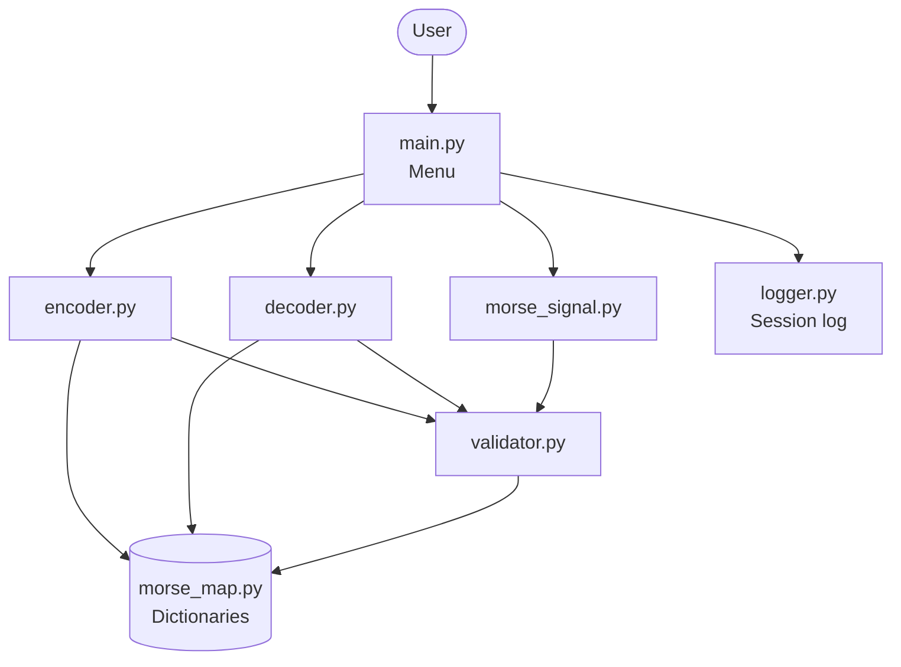
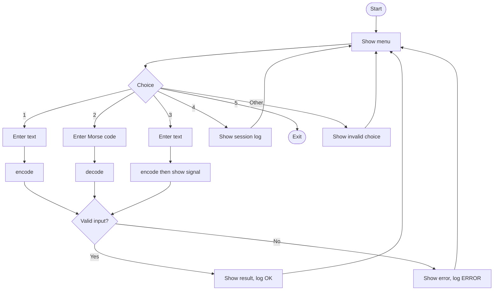
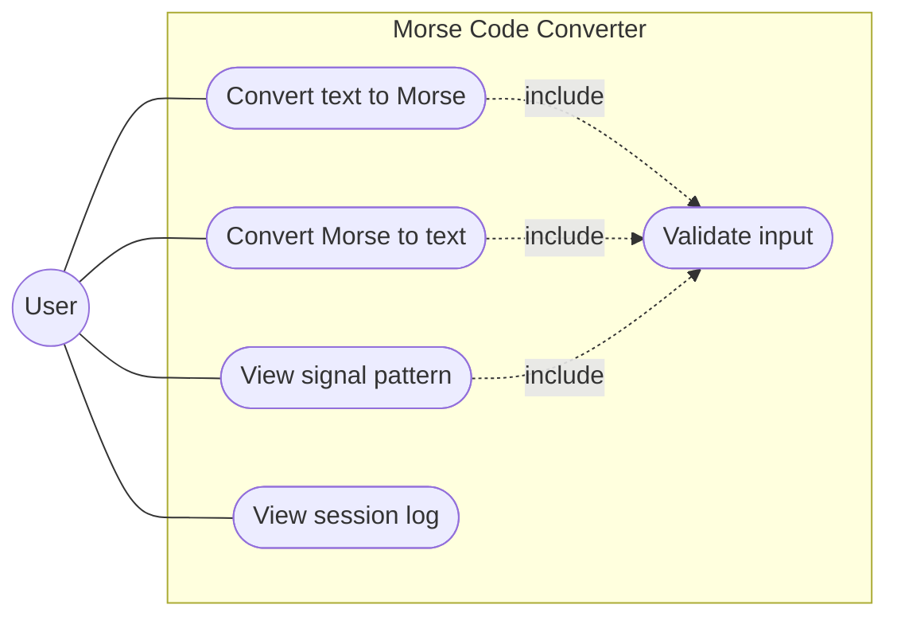
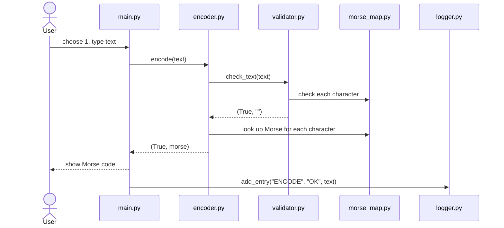
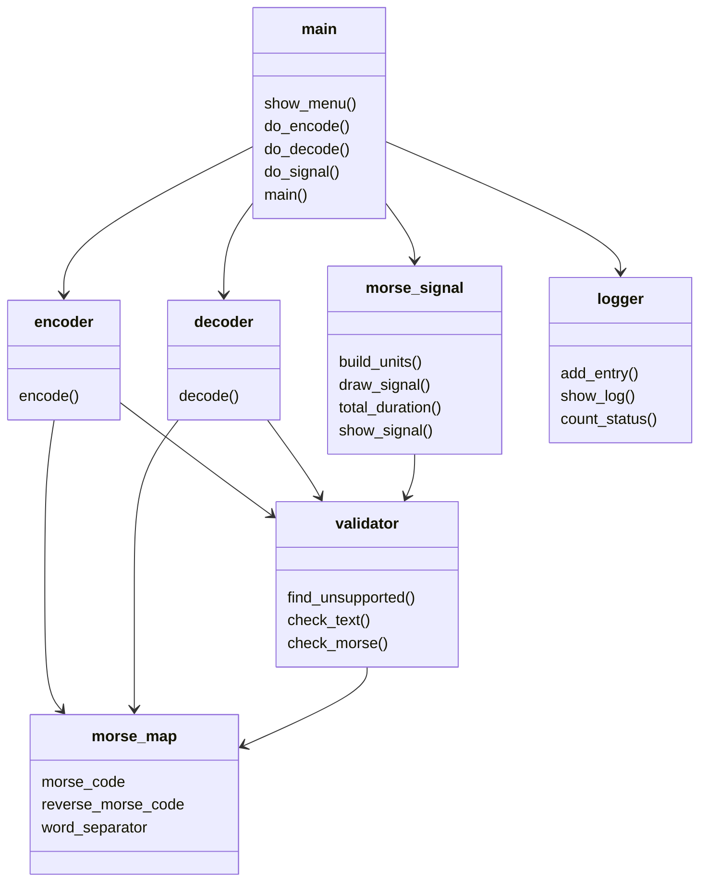

# Design Diagrams

Written in Mermaid (GitHub shows them automatically). For the PDF report, paste each block into https://mermaid.live and export as an image, or redraw in draw.io.

## 1. System Architecture

## 2. Workflow Diagram

## 3. Use Case Diagram

## 4. Sequence Diagram (Text to Morse)

## 5. Component Diagram

The program uses functions in modules (no classes), so a component view is used.

## 6. ER Diagram

Not applicable: the project uses no database or file storage.
